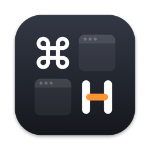
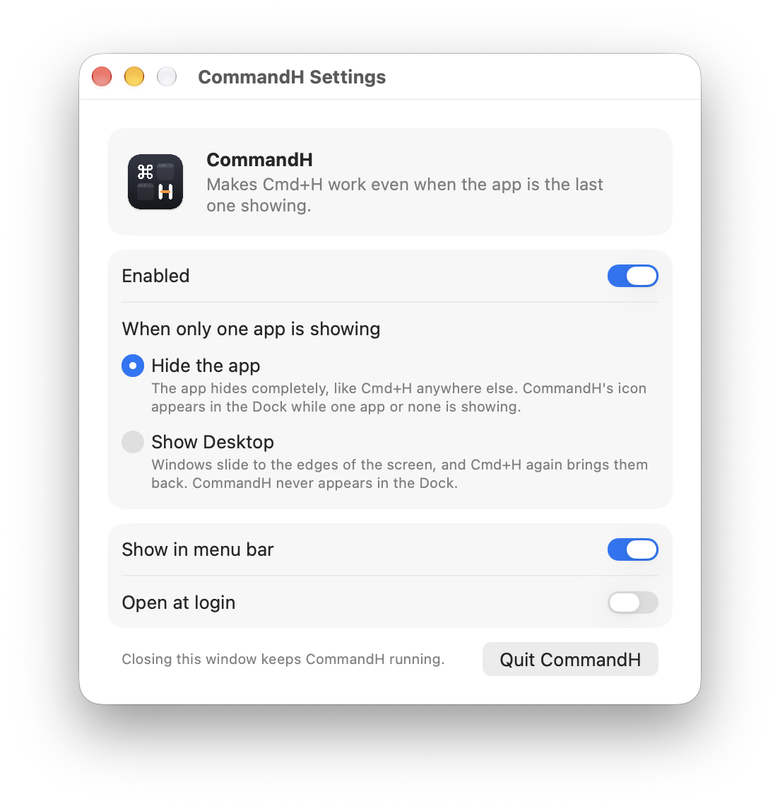
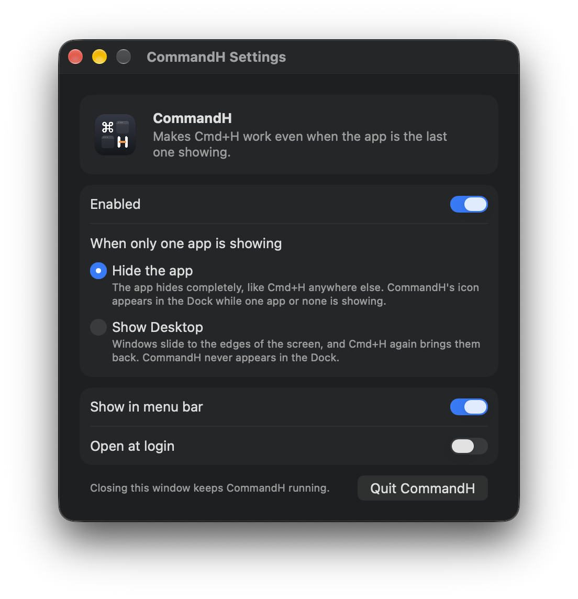
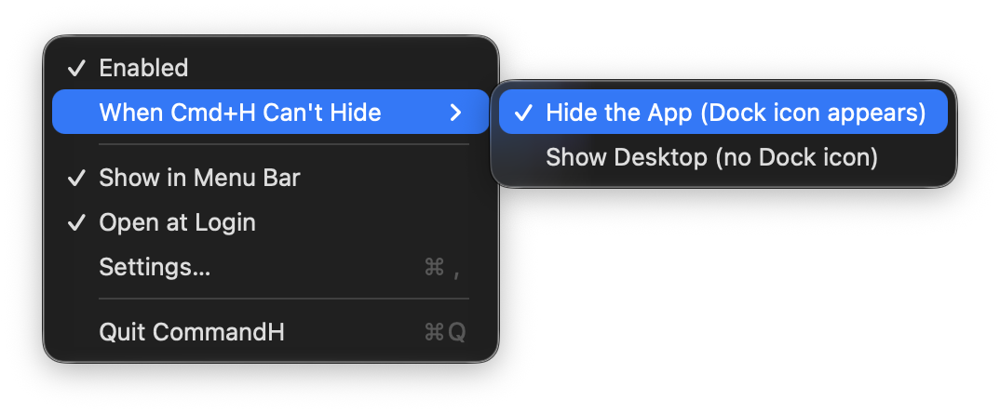

<p align="center">
  
</p>

<h1 align="center">CommandH</h1>

<p align="center">
  Make <b>Cmd+H</b> hide the last app on your Mac, so you can actually see your desktop.
</p>

---

macOS has an odd rule: **you can't hide the last visible app.** When every other app is already hidden, pressing Cmd+H on the one that's left does nothing. The window stays put and you never get to your desktop.

CommandH is a tiny, free, open source menu bar app that fixes this. With it running, Cmd+H works the same way every time, even on the last app.

- No permissions to grant (no Accessibility, no Screen Recording)
- No network access, no analytics, no data collected
- Lives in your menu bar, or nowhere at all if you prefer
- Requires macOS 14 Sonoma or later

## Contents

- [Install](#install)
- [Using CommandH](#using-commandh)
- [Settings](#settings)
- [The menu bar menu](#the-menu-bar-menu)
- [Keyboard shortcuts](#keyboard-shortcuts)
- [Troubleshooting](#troubleshooting)
- [How it works](#how-it-works)
- [Uninstall](#uninstall)
- [Building and contributing](#building-and-contributing)
- [Support the project](#support-the-project)

## Install

CommandH is currently installed by building it from source. It takes about a minute.

1. Install Apple's command line tools if you don't have them:
   ```sh
   xcode-select --install
   ```
2. Clone this repo and build:
   ```sh
   git clone https://github.com/MattSenter/commandh.git
   cd commandh
   ./build.sh --install
   ```
   This builds `CommandH.app`, copies it to your Applications folder, and opens it.
3. The settings window appears. Turn on **Open at login** so CommandH is always ready.

That's it. Hide apps the way you normally do. When you get down to the last one, Cmd+H now hides it too.

## Using CommandH

There's nothing new to learn. Keep using Cmd+H.

- **When two or more apps are showing,** CommandH stays out of the way and Cmd+H behaves exactly as it always has.
- **When only one app is showing,** CommandH steps in so Cmd+H still works. What happens next depends on the method you pick in [Settings](#settings).

To bring a hidden app back, click its Dock icon or switch to it with Cmd+Tab, as usual.

### Two ways to handle the last app

| | Hide the app (default) | Show Desktop |
|---|---|---|
| What you see | The app hides completely, just like Cmd+H on any other app | Windows slide to the edges of the screen |
| Getting it back | Click its Dock icon or use Cmd+Tab | Press Cmd+H again, or click the app |
| Dock icon | CommandH's icon appears in the Dock while one app or none is showing | Never appears in the Dock |
| Best for | People who want a real hide | People who never want CommandH in the Dock |

**Why does a Dock icon appear in "Hide the app" mode?** macOS only refuses to hide an app when it would leave no regular app on screen. CommandH briefly becomes a regular app (one with a Dock icon) so that your last app is no longer the last one. Regular apps always get a Dock icon, and there's no way around that. The icon goes away again as soon as two or more apps are showing. See [How it works](#how-it-works) for the details.

## Settings

Open the settings window by opening CommandH from your Applications folder (or Spotlight, or Launchpad), by choosing **Settings…** from the menu bar icon, or by clicking CommandH's Dock icon while it's showing.

<p align="center">
  
  
</p>

| Setting | What it does |
|---|---|
| **Enabled** | Turns CommandH on or off without quitting it. When off, Cmd+H behaves like stock macOS. |
| **When only one app is showing** | Chooses **Hide the app** or **Show Desktop**. See [the comparison above](#two-ways-to-handle-the-last-app). |
| **Show in menu bar** | Shows or removes the ⌘H icon in your menu bar. With it off, CommandH runs invisibly. Open CommandH from your Applications folder to get back to this window. |
| **Open at login** | Starts CommandH automatically when you log in. It starts quietly, without opening this window. |
| **Quit CommandH** | Actually quits the app. Closing the window (or pressing Cmd+Q) only closes the window and leaves CommandH running. |

Settings are saved automatically and apply right away.

## The menu bar menu

Click the ⌘H icon in your menu bar for quick access to the same settings.

<p align="center">
  
</p>

- **Enabled**: turn CommandH on or off.
- **When Cmd+H Can't Hide**: pick **Hide the App** or **Show Desktop**.
- **Show in Menu Bar**: uncheck to remove the icon. You can also hold Cmd and drag the icon out of the menu bar.
- **Open at Login**: start CommandH when you log in.
- **Settings…**: open the settings window.
- **Quit CommandH**: quit the app.

## Keyboard shortcuts

While the CommandH settings window is in front:

| Shortcut | What it does |
|---|---|
| Cmd+W | Closes the settings window. CommandH keeps running. |
| Cmd+Q | Also closes the window and keeps CommandH running, so a stray Cmd+Q never turns it off. Use **Quit CommandH** to quit for real. |
| Cmd+H | Hides CommandH like any other app. |
| Cmd+, | Opens settings. |

## Troubleshooting

**Cmd+H still does nothing on the last app.**
Make sure CommandH is running (open it from your Applications folder) and that **Enabled** is on. If you use **Show Desktop**, check that the Show Desktop option isn't grayed out (see below).

**A CommandH icon showed up in my Dock.**
That's expected in **Hide the app** mode whenever one app or none is showing. It disappears once a second app is showing. If you'd rather never see it, switch to **Show Desktop**.

**After hiding everything, clicking the desktop brought Finder windows back.**
That's normal macOS behavior: clicking the desktop switches to Finder, and switching to a hidden app shows its windows again. Hidden apps you haven't clicked stay hidden.

**In Show Desktop mode, I can still see the edges of my windows.**
That's how macOS's Show Desktop works. Press Cmd+H again or click a window edge to bring everything back. For a complete hide, use **Hide the app**.

**The Show Desktop option is grayed out.**
Show Desktop relies on an internal macOS feature. If a future version of macOS removes it, CommandH grays the option out rather than misbehave. **Hide the app** keeps working.

**I turned off the menu bar icon and can't find CommandH.**
Open CommandH from your Applications folder. The settings window appears and you can turn the icon back on.

**Open at login doesn't stay on.**
macOS only allows apps in a stable location to open at login. Make sure CommandH is in your Applications folder (`./build.sh --install` puts it there), then turn the setting on again.

**The menu bar shows "CommandH" after I hide my last app.**
In **Hide the app** mode, CommandH becomes the active app after the last app hides, so its name appears in the menu bar. Click any app or the desktop to move on.

## How it works

Before writing CommandH, we tested every way we could find to hide the last visible app directly. All of them fail:

| Approach | Result |
|---|---|
| `NSRunningApplication.hide()` | Refused |
| AppleScript (`set visible of process ... to false`) | Refused when the app is the last one showing |
| Accessibility (`kAXHiddenAttribute`) | Reports success, nothing hides |
| Private LaunchServices (`_LSSetApplicationInformationItem`) | Reports success, nothing hides |
| Carbon `ShowHideProcess` | Refused |

All of these hand off to the same check inside macOS, and that check only counts **regular apps**, the kind with a Dock icon. Menu bar only apps don't count. Even when the hide is forced through, macOS immediately unhides the most recently used app so that something is always on screen.

**Hide the app** works within that rule. When one app or none is showing, CommandH switches itself to a regular app with a 1 by 1 pixel, nearly transparent window. Your last app is then no longer the last one, so its own Cmd+H works normally, and macOS hands focus to CommandH instead of unhiding something else. When two or more apps are showing, CommandH switches back to a menu bar only app.

**Show Desktop** takes a different path. While the front app is the only one showing, CommandH registers Cmd+H as a global hotkey (released as soon as that stops being true) and triggers macOS's built-in Show Desktop. Outside that one case, Cmd+H goes straight to your apps.

Neither method needs any permission, and CommandH never reads your screen or your keystrokes. The global hotkey only exists in Show Desktop mode and only while one app is showing.

The whole app is under 500 lines of Swift in [`Sources/`](Sources).

## Uninstall

1. Choose **Quit CommandH** from the menu bar icon or the settings window.
2. If **Open at login** was on, turn it off first, or remove CommandH in System Settings > General > Login Items.
3. Drag `/Applications/CommandH.app` to the Trash.
4. Optionally remove its settings:
   ```sh
   defaults delete com.mattsenter.CommandH
   ```

## Building and contributing

```sh
./build.sh            # builds build/CommandH.app (ad-hoc signed)
./build.sh --install  # also copies it to /Applications and opens it
swift Tools/make-icon.swift   # regenerates the app icon in Resources/
```

| Path | What's there |
|---|---|
| `Sources/main.swift` | App delegate, the two hiding methods, menus |
| `Sources/SettingsView.swift` | The SwiftUI settings window |
| `Sources/MenuBarIcon.swift` | The menu bar icon, drawn in code |
| `Tools/make-icon.swift` | Renders the app icon |
| `scripts/release.sh` | Developer ID signing and notarization for releases |
| `project.yml`, `fastlane/` | The Mac App Store build (sandboxed, without Show Desktop). See [docs/AppStore.md](docs/AppStore.md) |
| `scripts/screenshots.sh` | Renders the App Store screenshots |

Issues and pull requests are welcome.

## Support the project

CommandH is free and always will be. If it saves you a little daily annoyance, you can tip me on Venmo.

<p align="center">
  <a href="https://venmo.com/u/MattSenter"><b>Tip @MattSenter on Venmo</b></a>
</p>

<p align="center">
  <a href="https://venmo.com/u/MattSenter">
    
  </a>
  <br>
  <sub>Scan with your phone</sub>
</p>

A tip is a thank you. It doesn't unlock anything, because there's nothing to unlock.

## License

[MIT](LICENSE). Built by [Matt Senter](https://www.mattsenter.com/?utm_source=github&utm_medium=readme&utm_campaign=commandh).
